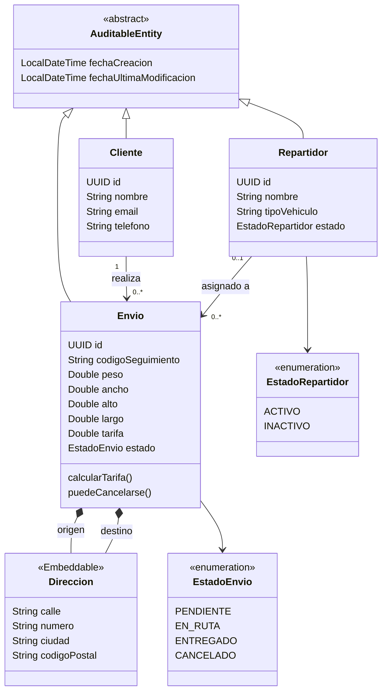

# 📦 LogiTrack · shipment-service


Microservicio de **LogiTrack** con **Spring Boot** y **MySQL** que gestiona el ciclo de vida de los envíos, su historial de auditoría y la asignación de repartidores. Realizado en el marco de la cursada de **Desarrollo y Arquitecturas Avanzadas de Software** (Universidad Nacional de Jujuy).

**Integrantes:** Jorge Agustín Armella · Lucas Nahuel Armella · Mauricio Fernando Benitez
 
---

## 🛠️ Tecnologías

| Tecnología                  | Uso |
|-----------------------------|-----|
| Java 25                     | Lenguaje |
| Spring Boot 3.4.3           | Framework base |
| Spring Data JPA / Hibernate | Persistencia |
| MySQL 8 (Docker)            | Base de datos |
| springdoc-openapi           | Documentación de la API (Swagger) |
| JUnit 5 / Mockito           | Pruebas |
| Maven (wrapper)             | Build |

## 🧱 Arquitectura

Arquitectura en capas, con DTOs que desacoplan la API REST de las entidades JPA.

```text
shipment-service/
├── controller/      # Endpoints REST
├── service/         # Lógica de negocio
├── repository/      # Repositorios (JpaRepository)
├── entity/          # Entidades JPA y enumeraciones
├── dto/             # Objetos de transferencia
└── exception/       # Excepciones y manejo global de errores
```

## 🗄️ Modelo de dominio



## 🚀 Puesta en marcha

**Requisitos:** Docker (Maven no hace falta, se usa el wrapper).

Levantar `shipment-service` junto con MySQL con un solo comando:

```bash
docker compose up --build
```

## 🧪 Pruebas

```bash
./mvnw test
```

## 📄 Licencia

Licencia MIT. Ver el archivo [LICENSE](LICENSE).
 